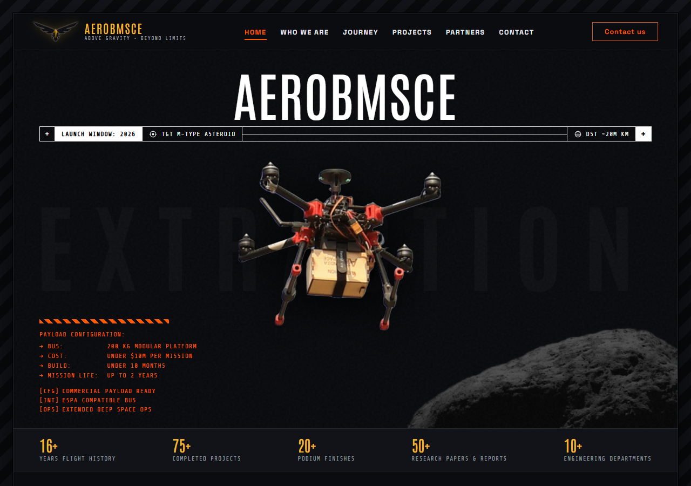
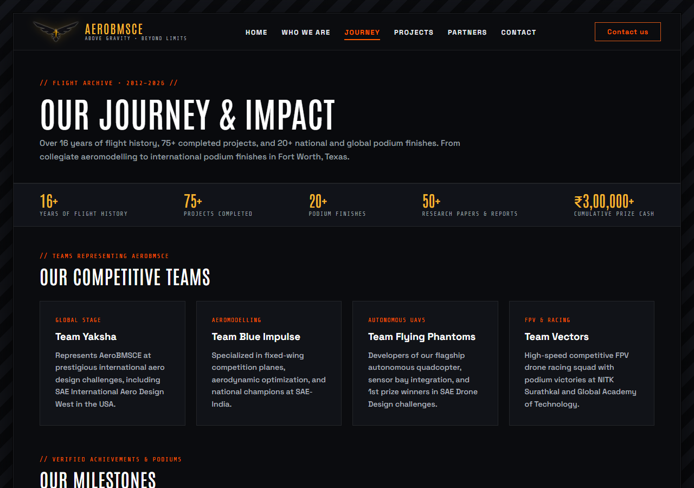
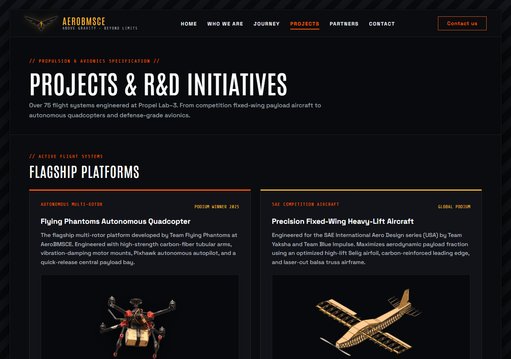
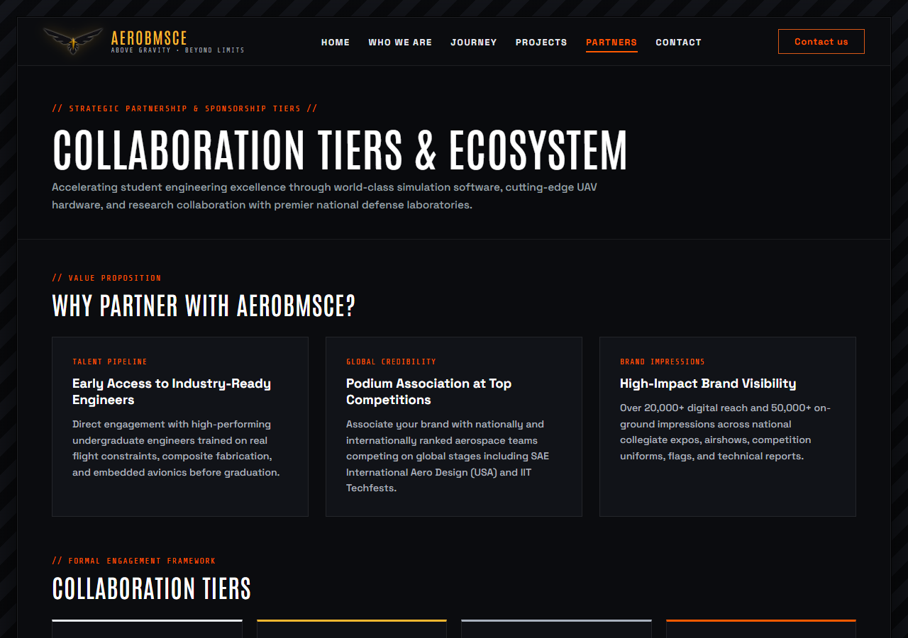
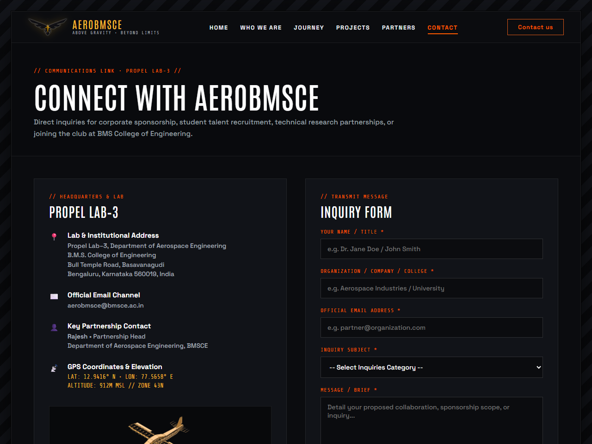

# Aerospace BMSCE — Official Web Portal

A multi-page web portal built for **Aerospace BMSCE (Propel Lab–3)**. This platform documents the team's competitive UAV squads, active defense and autonomous R&D initiatives, verified 2018–2026 competition milestones, and industry partnership tiers.

---

## Live Browser Preview

Click any of the links below to render and view the pages directly in your browser:

* **[View Home Page (index.html)](https://htmlpreview.github.io/?https://github.com/ananyashreeas/AEROBMSCE/blob/main/index.html)**
* **[View Journey & Milestones (journey.html)](https://htmlpreview.github.io/?https://github.com/ananyashreeas/AEROBMSCE/blob/main/journey.html)**
* **[View Projects & R&D (projects.html)](https://htmlpreview.github.io/?https://github.com/ananyashreeas/AEROBMSCE/blob/main/projects.html)**
* **[View Partners & Tiers (partners.html)](https://htmlpreview.github.io/?https://github.com/ananyashreeas/AEROBMSCE/blob/main/partners.html)**
* **[View Contact Portal (contact.html)](https://htmlpreview.github.io/?https://github.com/ananyashreeas/AEROBMSCE/blob/main/contact.html)**

---

## Portal Structure & Page Previews

### 1. Home (`index.html`)
Features the deep-space hero section with an exploded drone cutout, HUD telemetry bar, credibility stats ribbon, core team overview (Who We Are, What We Do, Why It Matters, Our Vision), and the 4 Competitive Squads.



---

### 2. Journey & Milestones (`journey.html`)
Full verified timeline spanning the 2018–2026 competition seasons, including national and international podium standings, technical awards, and the lab photo gallery.



---

### 3. Projects & R&D (`projects.html`)
Technical specifications for the Flying Phantoms drone, CAD plane airframe, and 7 active and upcoming R&D initiatives:
* DRDO Defense Project
* Indigenous Flight Controller
* Custom Electronic Speed Controller (ESC)
* GPS-Denied Navigation
* Morphing Wings & Advanced UAV Systems



---

### 4. Partners & Sponsorship (`partners.html`)
Sponsorship value proposition, formal collaboration tiers with official tier icons, and the dual-contrast ecosystem logo showcase (DRDO, CSIR-NAL, Siemens, SimScale, flow5, etc.).



---

### 5. Contact Us (`contact.html`)
Propel Lab–3 location details, GPS coordinates, partnership coordinator contact information, and a validated contact form.



---

## Tech Stack
* **HTML5** — Semantic multi-page structure
* **CSS3** (`style.css`) — Custom layout, styling, and responsive grid design
* **JavaScript** (`script.js`) — Interactive navigation, telemetry elements, and form validation

---

## Local Setup

To run this project on your local machine:

1. Clone the repository:
   ```bash
   git clone [https://github.com/ananyashreeas/AEROBMSCE.git](https://github.com/ananyashreeas/AEROBMSCE.git)
   cd AEROBMSCE
